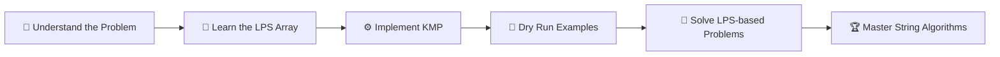

<!-- Animated wave header -->

<!-- Typing animation -->

 

  

-orange?style=for-the-badge)

---

## 🎯 About

> *"Don't go back. Use what you already matched."* 🧩

**KMP (Knuth-Morris-Pratt)** is one of the most elegant string matching algorithms ever designed. Instead of restarting the comparison from scratch after every mismatch, it uses a precomputed **LPS (Longest Prefix Suffix)** array to skip useless comparisons. 🏃‍♂️💨

| 🐢 Naive Approach | ⚡ KMP Approach |
|:---:|:---:|
| `O(n × m)` | `O(n + m)` |
| Re-checks characters | Never re-checks matched characters |
| Slow on repetitive text | Blazing fast everywhere |

---

## 🎬 Learning Playlist

### 📺 KMP Applications & LPS Related Problems

**This playlist covers the application of KMP and LPS-related problems**

 

  

🔗 KMP - https://youtu.be/qases-9gOpk?si=sBB9EeLA7FLhhye6

---

## 🧠 What You'll Master

- 🔹 **Very clear intuition** behind KMP
- 🔹 **Dry run explanations** step by step
- 🔹 Building the **LPS array** from scratch
- 🔹 Applying KMP to real **interview problems**
- 🔹 Solutions in **C++** & **Java** 💻

---

## 🗺️ Roadmap

---

## ☕ Support codestorywithMIK (No Pressure)

Education here is **100% free and always will be.** 💙
If the content helped you and you'd like to support the channel with a coffee:

**UPI:** `imammazhar4@ybl`

---

### ⭐ If this helped you, give the repo a star! ⭐

